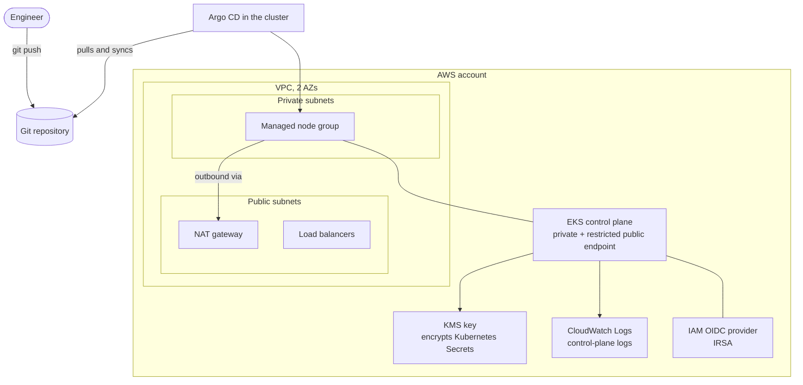

# eks-gitops-platform

Terraform for a small EKS cluster that Argo CD would then run workloads on.

> **Status: applied once to a real AWS account (2026-11-20), drilled, and destroyed. The account was checked afterwards for leftovers.**
> Evidence: [`docs/evidence/real-apply-2026-11-20.txt`](docs/evidence/real-apply-2026-11-20.txt). Before that, it was only validated offline.

## Architecture



## What it creates
- A VPC with private subnets (nodes and pods) and small public subnets (NAT and load balancers) across 2 or 3 zones.
- NAT: one shared gateway by default (`single_nat_gateway = true`), or one per zone.
- An EKS cluster with a **private** API endpoint and a **public** endpoint reachable **only from CIDRs you list**.
- A managed node group, the core add-ons (CoreDNS, kube-proxy, VPC CNI), IRSA (OIDC provider), control-plane logs with a
  retention limit, and Kubernetes Secrets encrypted with a customer-managed KMS key.
- Module versions pinned exactly: `terraform-aws-modules/vpc/aws` 6.7.3 and `terraform-aws-modules/eks/aws` 21.29.0,
  AWS provider `~> 6.70`.

## Safety choices that are enforced, not just documented
| Choice | How it is enforced |
|---|---|
| The Kubernetes API is never open to the world | `endpoint_public_access_cidrs` has **no default**, and a validation rejects `0.0.0.0/0`, `::/0`, an empty list and malformed CIDRs |
| No state or variable files in Git | `.gitignore` for `*.tfstate`, `.terraform/`, `terraform.tfvars` |
| Sizes make sense | validation: 1 <= min <= desired <= max |
| Kubernetes version is explicit | required input (leaving it null breaks plan-time node-group sizing in this module version) |

## What was and was not checked
### Real AWS run, 2026-11-20 (ap-south-1, Kubernetes 1.34, run from AWS CloudShell)
- `terraform apply`: 55 resources created in about 12 minutes (the control plane alone took about 9).
- Live cluster: 2 nodes `Ready` in private subnets with no external IP; CoreDNS, kube-proxy and VPC CNI pods all `Running`.
- Cluster settings read back with `aws eks describe-cluster`: public endpoint limited to one /32 (not `0.0.0.0/0`), private endpoint on,
  Secrets encrypted, five control-plane log types on.
- GitOps drill: installed Argo CD (v3.6.2) and synced one Application from a **public example repository**
  (`argoproj/argocd-example-apps`, `guestbook`, automated sync with self-heal). I deleted its Deployment with `kubectl`;
  Argo CD recreated it within about 30 seconds and the app returned to `Synced` and `Healthy`.
- `terraform destroy`: 55 destroyed in about 11 minutes. A region sweep afterwards found no cluster, instance, NAT gateway,
  Elastic IP, load balancer, volume, VPC or log group left.
- **Not tested:** the `bootstrap/root-application.yaml` app-of-apps (the drill used one Application, not the root), a load balancer or
  ingress, IRSA roles in use, node scaling, a private-only endpoint, and cost (nothing was measured, so no figure is quoted here).

### Offline checks, 2026-10-23
Run on 2026-10-23, output in `docs/evidence/validate.txt`:
- `terraform fmt -check`: passes
- `terraform init -backend=false` and `terraform validate`: pass
- `terraform test` against a **mocked** AWS provider: 8 of 8 pass (7 prove bad input is rejected, 1 proves a valid config plans)
- `checkov`: 3 passed, 0 failed, 3 skipped. The skips are documented in `main.tf`:
  `CKV_TF_1` twice (registry modules pinned to an exact version instead of a git commit hash) and `CKV_AWS_394`
  (only the first 2 or 3 zones are used)
- `tflint`: **not run** (not installed)
- The mocked plan proves the code is consistent, not that AWS will accept it; the real run above is what showed AWS accepts it.

## Bootstrapping Argo CD on this cluster
1. `terraform apply` (with your own account and `terraform.tfvars`), then the `kubeconfig_command` output. (Done in the 2026-11-20 run.)
2. Install Argo CD (Helm chart or the official manifests) into the `argocd` namespace. (Done, official manifest, v3.6.2.)
3. Apply `bootstrap/root-application.yaml` (**not applied**; the drill used a single public example Application instead): the **root** Application watches a folder of child Applications
   (app-of-apps), so adding a workload is a Git commit, not a `kubectl apply`.
4. Children: the workloads (for example the self-healing lab chart) and Argo Rollouts.
Locally, the same Argo CD ideas were also run on a kind cluster; see the `k8s-self-healing-lab` repository.

## Cost warning
This is **not free**. An EKS control plane, the worker instances, NAT gateway(s), load balancers, CloudWatch logs and KMS
all bill while they exist, and NAT gateways bill even when idle. I have not quoted prices because I did not verify
current ones, and I did not measure the cost of my run: check the AWS pricing pages and set a budget alarm before applying, and run `terraform destroy` when done.

## Use
```bash
cp terraform.tfvars.example terraform.tfvars   # edit: your IP in endpoint_public_access_cidrs, a supported kubernetes_version
terraform init
terraform validate
terraform test                                  # no AWS needed
# terraform plan / apply: only with your own AWS account, after reading the cost warning; destroy when done
```
