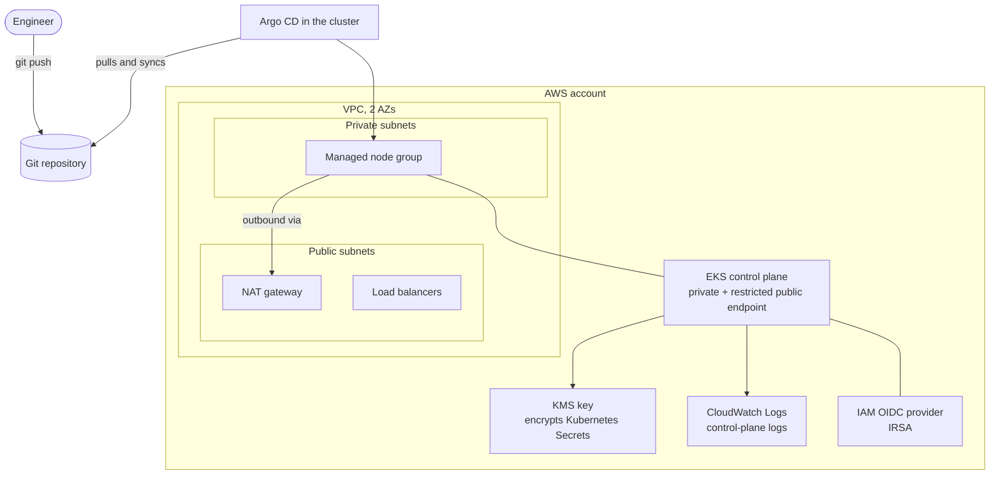

# eks-gitops-platform

Terraform for a small EKS cluster that Argo CD would then run workloads on.

> **Status: validated with `terraform validate`, NOT applied to a real AWS account.**
> No credentials were used and nothing was created. See "What was and was not checked" below.

## Architecture



## What it creates
- A VPC with private subnets (nodes and pods) and small public subnets (NAT and load balancers) across 2 or 3 zones.
- NAT: one shared gateway by default (`single_nat_gateway = true`), or one per zone.
- An EKS cluster with a **private** API endpoint and a **public** endpoint reachable **only from CIDRs you list**.
- A managed node group, the core add-ons (CoreDNS, kube-proxy, VPC CNI), IRSA (OIDC provider), control-plane logs with a
  retention limit, and Kubernetes Secrets encrypted with a customer-managed KMS key.
- Module versions pinned exactly: `terraform-aws-modules/vpc/aws` 6.7.3 and `terraform-aws-modules/eks/aws` 21.29.0,
  AWS provider `~> 6.70`.

## Safety choices that are enforced, not just documented
| Choice | How it is enforced |
|---|---|
| The Kubernetes API is never open to the world | `endpoint_public_access_cidrs` has **no default**, and a validation rejects `0.0.0.0/0`, `::/0`, an empty list and malformed CIDRs |
| No state or variable files in Git | `.gitignore` for `*.tfstate`, `.terraform/`, `terraform.tfvars` |
| Sizes make sense | validation: 1 <= min <= desired <= max |
| Kubernetes version is explicit | required input (leaving it null breaks plan-time node-group sizing in this module version) |

## What was and was not checked
Run on 2026-10-23, output in `docs/evidence/validate.txt`:
- `terraform fmt -check`: passes
- `terraform init -backend=false` and `terraform validate`: pass
- `terraform test` against a **mocked** AWS provider: 8 of 8 pass (7 prove bad input is rejected, 1 proves a valid config plans)
- `checkov`: 3 passed, 0 failed, 3 skipped. The skips are documented in `main.tf`:
  `CKV_TF_1` twice (registry modules pinned to an exact version instead of a git commit hash) and `CKV_AWS_394`
  (only the first 2 or 3 zones are used)
- `tflint`: **not run** (not installed)
- **Not done:** `terraform plan` against a real account, `terraform apply`, anything on a real cluster. The mocked plan
  proves the code is consistent, not that AWS will accept it (quotas, region support, IAM permissions, version support).

## Bootstrapping Argo CD on this cluster (the plan, not run)
1. `terraform apply` (with your own account and `terraform.tfvars`), then the `kubeconfig_command` output.
2. Install Argo CD (Helm chart or the official manifests) into the `argocd` namespace.
3. Apply `bootstrap/root-application.yaml`: the **root** Application watches a folder of child Applications
   (app-of-apps), so adding a workload is a Git commit, not a `kubectl apply`.
4. Children: the workloads (for example the self-healing lab chart) and Argo Rollouts.
Locally, the same Argo CD ideas were run on a kind cluster; see the `k8s-self-healing-lab` repository.

## Cost warning
This is **not free**. An EKS control plane, the worker instances, NAT gateway(s), load balancers, CloudWatch logs and KMS
all bill while they exist, and NAT gateways bill even when idle. I have not quoted prices because I did not verify
current ones: check the AWS pricing pages and set a budget alarm before applying, and run `terraform destroy` when done.

## Use
```bash
cp terraform.tfvars.example terraform.tfvars   # edit: your IP in endpoint_public_access_cidrs, a supported kubernetes_version
terraform init
terraform validate
terraform test                                  # no AWS needed
# terraform plan / apply: only with your own AWS account, after reading the cost warning
```
